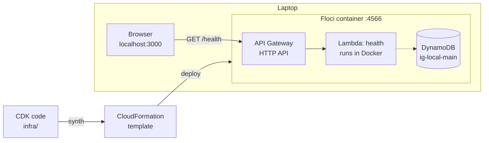

# Step 1: Skeleton + Floci spike

## What got built

- A **CDK app** (`infra/`) that describes the AWS setup in TypeScript.
- One **DynamoDB table** (`ig-local-main`) that every later feature will share.
- One **Lambda** (`ig-local-health`) behind an **HTTP API**: `GET /health`.
- A **Next.js page** that calls `/health` and shows if the API is up.
- A **spike** that proved every AWS service we need works on Floci (12/12). See `floci-compat.md`.

## How it fits together



## Why it's built this way

**Infrastructure as code (CDK).** The whole AWS setup is TypeScript in git. Nobody clicks
around the console. The same code deploys to Floci today and to real AWS later.

**CDK → CloudFormation.** CDK doesn't call AWS directly. It writes a CloudFormation
template (a big JSON file), and CloudFormation creates the resources. Floci emulates
CloudFormation too, which is why plain `cdk deploy` works.

**Stages + a safety guard.** `-c stage=local` refuses to run unless `AWS_ENDPOINT_URL`
points at Floci, and `-c stage=aws` refuses while it does. So you can't deploy to the
wrong place by accident.

**One table for everything.** DynamoDB "single-table design": users, posts, likes and feeds
all live in one table, told apart by key prefixes. More in step 2.

## Things the spike taught us

- Floci's Cognito tokens only pass the API's JWT check if Floci runs with
  `FLOCI_BASE_URL=http://127.0.0.1:4566`. That's why we start Floci from `docker-compose.yml`.
- Restarting or resetting Floci wipes everything. Just run `npm run deploy:local` again.
- CDK's handy S3 helpers secretly add a Lambda ("custom resource"). We avoid them.

## Interview angle

- *"How do you manage environments?"* The same IaC with a stage parameter, deployed per
  environment, plus guardrails against deploying to the wrong account.
- *"Why serverless?"* No servers to patch, it scales to zero (costs ~nothing idle), and you pay per request.
  Tradeoffs: cold starts, execution time limits, vendor lock-in.
- *"How do you test cloud code locally?"* An emulator (Floci/LocalStack) for fast loops,
  then a real cloud environment for what emulators fake: IAM, networking, limits.

## Poke it

```powershell
npm run floci:up              # start Floci
npm run deploy:local          # deploy (prints the local API URL)
npm -w web run dev            # UI at http://localhost:3000
npm run spike                 # re-run the compatibility check (~2 min)
npm test                      # unit tests
```

With the Floci env set (`$env:AWS_ENDPOINT_URL="http://localhost:4566"`, keys `test`):

```powershell
aws dynamodb describe-table --table-name ig-local-main
aws lambda list-functions --query "Functions[].FunctionName"
aws cloudformation list-stacks
docker logs floci --tail 50
```

## How big companies do it

| Here | At scale |
|---|---|
| One stack, two stages | Many stacks per service, an **AWS account per environment** (dev / staging / prod) via AWS Organizations |
| `cdk deploy` from a laptop | **CI/CD pipelines** (GitHub Actions, CodePipeline): PR → tests → deploy to staging → approval → prod |
| Emulator for local testing | Emulator for the fast loop **plus** ephemeral cloud environments per PR for realistic tests |
| Lambda + HTTP API | Same for many teams; very high, steady traffic often moves to containers (ECS/EKS) where it's cheaper |
