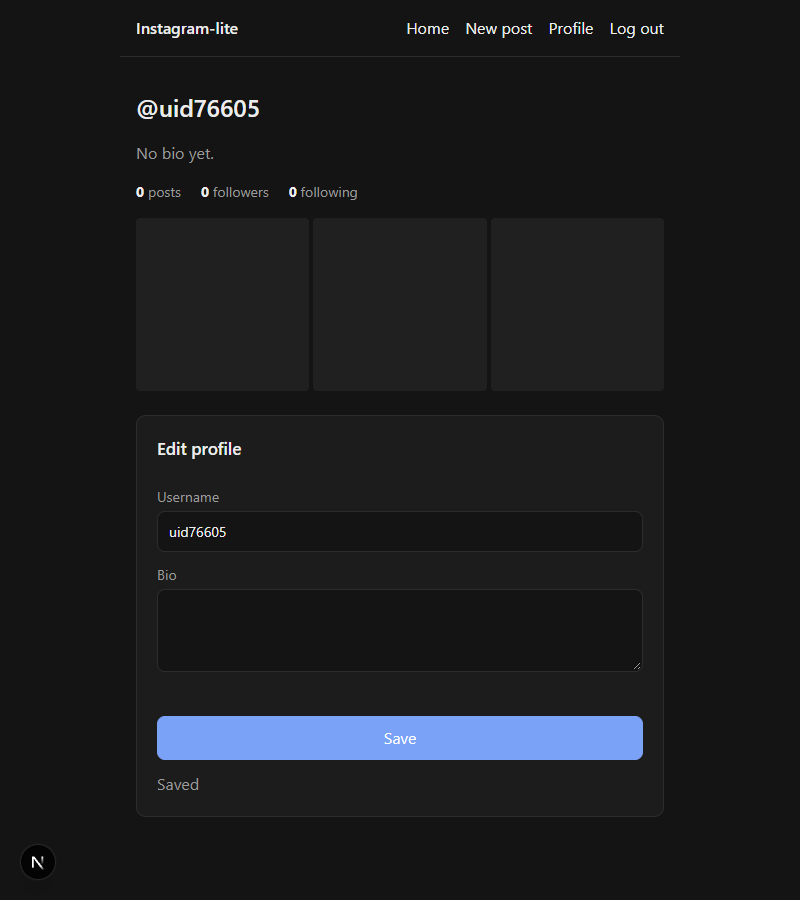
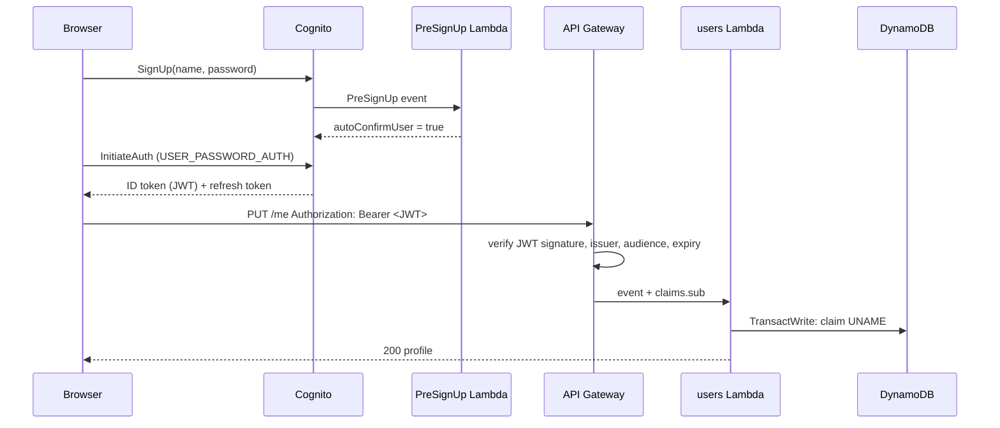

# Step 2: Login + profiles

## What got built

- **Cognito user pool**: sign up and log in with a login name + password.
- A **PreSignUp trigger** (tiny Lambda) that auto-confirms new users, so no email codes.
- A **JWT authorizer** on the API: every route except `/health` needs a valid login token.
- A **users Lambda** with `GET /me`, `PUT /me` and `GET /users/{username}`.
- **Unique usernames**, enforced by DynamoDB transactions (no two users can grab the same name, even at the same millisecond).
- **Pages**: `/login` (log in / create account), `/me` (your profile, edit), `/u?name=ann` (someone else's).



## How a request flows



## The ideas to learn

### 1. Authentication vs authorization
- **Authentication**: *who are you?* Cognito checks the password and gives you a token.
- **Authorization**: *what can you do?* Our API only lets you edit **your own** profile,
  because the user id comes from the token (`sub`), never from the request body.

### 2. JWT (JSON Web Token)
A JWT is three base64 parts: `header.payload.signature`.
- **payload** holds claims: `sub` (user id), `iss` (who issued it), `aud` (which app), `exp` (expiry).
- **signature**: Cognito signs with its private key. API Gateway checks it with Cognito's
  public keys (the JWKS URL). If someone edits the payload, the signature breaks.
- API Gateway rejects bad tokens **before** our Lambda runs, so our code never sees them.

Try it: paste a token into https://jwt.io (decoding is safe; it's not encrypted, just signed).

### 3. Tokens in the browser
- The **ID token** lives 1 hour. The **refresh token** (~30 days) gets a new ID token silently.
- We store them in `localStorage`. That's simple, but any injected script (XSS) could read them.
  Production apps often use httpOnly cookies set by a backend instead. Know this tradeoff for interviews.

### 4. Single-table design + uniqueness
DynamoDB has no "UNIQUE" column constraint. The trick:

| Item | pk | sk |
|---|---|---|
| profile | `USER#<sub>` | `PROFILE` |
| username claim | `UNAME#ann` | `UNAME` |

Creating a profile = **one transaction** writing both items, with
`attribute_not_exists(pk)` on the claim. If the name exists, the whole transaction fails, so
nothing half-written is left behind. Renaming = take the new claim + delete the old claim + update the profile, all or nothing.

### 5. Cognito triggers
Cognito calls your Lambda at key moments: PreSignUp, PostConfirmation, PreTokenGeneration.
We use PreSignUp to skip verification. In a real app you'd keep email verification on.

## Interview angle
- *"How do you make usernames unique in DynamoDB?"* A separate claim item + conditional put in a transaction.
- *"Where do you validate tokens?"* At the edge (API Gateway authorizer), not in every service.
- *"Why not trust the user id from the request?"* Anyone can send any id. Only the signed token proves who they are.
- *"Session vs JWT?"* Server sessions are easy to revoke but need shared storage. JWTs are stateless and scale easily,
  but are hard to revoke before they expire (so keep them short-lived).

## Poke it
```powershell
npm run deploy:local      # writes web/.env.local with API + Cognito ids
npm -w web run dev        # http://localhost:3000 → create an account
npm run smoke             # scripted API + browser test (needs the dev server)
npm -w services run test:int   # DynamoDB integration tests incl. the race
```
Look at the raw items:
```powershell
aws dynamodb scan --table-name ig-local-main --max-items 10
aws cognito-idp list-users --user-pool-id <UserPoolId from infra/cdk.out/outputs-local.json>
```

## How big companies do it

| Here | At scale |
|---|---|
| Auto-confirm sign-up | Email/phone verification, bot protection (CAPTCHA, rate limits), MFA |
| Tokens in `localStorage` | **httpOnly secure cookies** via a backend-for-frontend (BFF), so scripts can't read tokens |
| Cognito | Cognito, Auth0/Okta, or an in-house identity service; social login (Google/Apple) |
| One users table | User data split by access pattern; usernames often in a separate uniqueness service or a relational DB |
| Retry on transaction conflicts | Same idea, plus idempotency keys on every write API |
