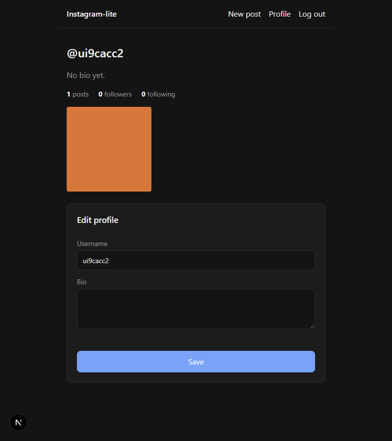
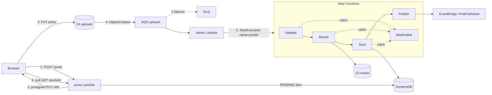

# Step 3: Photo upload pipeline

## What got built

- `POST /posts` creates a **PENDING** post and returns a **presigned URL**.
- The browser uploads the photo **straight to S3** with that URL. Our API never touches the bytes.
- S3 drops an event on an **SQS queue** (with a dead-letter queue for poison messages).
- A **starter Lambda** reads the queue and starts a **Step Functions** workflow:
  **Validate → Resize → Save → Publish**. Any failure → **MarkFailed**.
- Resize makes a 320px thumb + a 1080px full JPEG into a private **media bucket**.
- Save flips the post to **READY**, adds it to the user's grid and bumps `postCount`, all in one transaction.
- Publish emits a **`PostPublished`** event on **EventBridge** (the feed listens to it in step 4).
- UI: **New post** page (pick, preview, share, "Processing…"), a profile **grid**, and a post page.



## The flow



## The ideas to learn

### 1. Presigned URLs (direct-to-S3 uploads)
The API signs a URL that allows **one PUT, to one key, for 5 minutes**. The browser uploads
straight to S3, so big files never pass through Lambda (6 MB payload limit, and you'd pay for the
time). It's the standard answer to *"how do users upload files?"*
- A PUT URL can't limit size, so the pipeline checks it afterwards. A **presigned POST** with a
  `content-length-range` policy can reject big files at upload time.

### 2. Queue between S3 and the work (SQS)
Why not let S3 call the Lambda directly? A queue gives you:
- **Buffering**: 10,000 uploads in a minute just wait in the queue.
- **Retries**: a message that fails becomes visible again after the visibility timeout.
- **Dead-letter queue**: after 3 failures it moves aside instead of retrying forever.
- **Partial batch failure**: the starter reports which messages failed, so only those retry.

### 3. Workflows (Step Functions)
Each step is a small Lambda. Step Functions handles **ordering, retries (Resize retries 2× with
backoff), error catching, and shows every run visually** (state, input, output per step). In an
interview: *"orchestration"* (a central workflow) vs *"choreography"* (services reacting to events).
We use both: orchestration inside the pipeline, choreography after it (EventBridge).

### 4. Idempotency: doing it twice must be harmless
SQS delivers **at least once**, so duplicates happen. Our defences:
- The execution is **named by postId**, and Step Functions refuses a second run with the same name.
- Save has a condition `status = PENDING`. A retry finds READY and changes nothing, so the count isn't doubled.

### 5. Sparse index
Only READY posts get `gsi1pk/gsi1sk`. DynamoDB indexes only items that have those attributes, so
the grid query never sees PENDING or FAILED posts, with no filtering needed.

### 6. TTL cleanup
PENDING posts get `ttl` = now + 1 day. If the upload never happens, DynamoDB deletes the item itself.

## Interview angle
- *"Design Instagram's upload"*: presigned upload → object storage → queue → async processing
  (thumbnails, moderation) → mark ready → notify followers (the feed, step 4) → serve via CDN (step 7).
- *"What if processing fails?"*: retries with backoff, a DLQ, a FAILED status the user sees, alarms on the DLQ (step 6).
- *"Exactly-once?"*: almost impossible. Aim for at-least-once delivery plus idempotent consumers.

## Poke it
```powershell
npm run smoke pipeline       # API upload → READY, fake PNG → FAILED
npm run smoke ui             # browser upload (needs npm -w web run dev)
aws stepfunctions list-executions --state-machine-arn <PipelineArn from outputs-local.json>
aws stepfunctions get-execution-history --execution-arn <arn> --query "events[].type"
aws s3 ls s3://ig-local-media-000000000000/media/ --recursive
aws sqs get-queue-attributes --queue-url <UploadsDlqUrl> --attribute-names ApproximateNumberOfMessages
```
