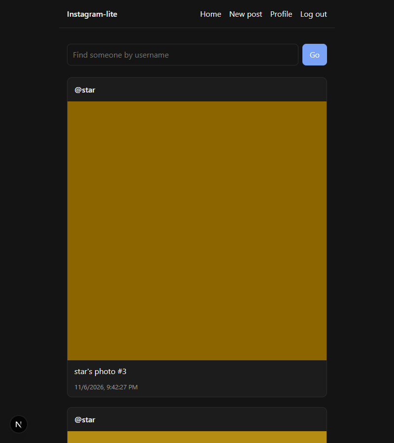
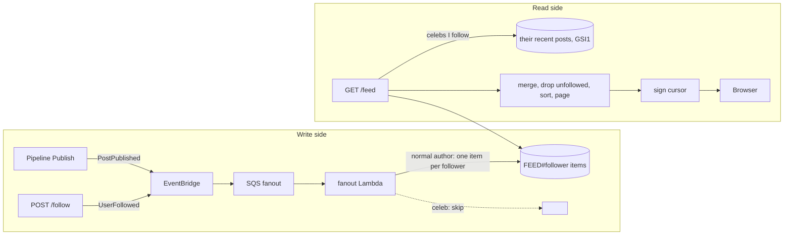

# Step 4: Follow + news feed

## What got built

- **Follow / unfollow** (`POST|DELETE /users/{id}/follow`): one transaction writes both directions
  of the relationship and both counters. Emits a **`UserFollowed`** event.
- A **fan-out Lambda** listening to `PostPublished` + `UserFollowed` (via EventBridge → SQS):
  - normal author posts → a pointer goes into **every follower's feed** (push)
  - a **celeb** (≥ 3 followers locally) posts → nothing is pushed
  - you follow someone → their last 10 posts are copied into your feed (backfill)
- **`GET /feed`**: your pushed items + recent posts of celebs you follow (pull), minus anyone you
  unfollowed, newest first, 10 per page, with a **signed cursor** (key in **Secrets Manager**).
- **Seed data** (`npm run seed`): alice, bob, carol, dave, eve, star (password `password1`).
  Log in as **bob** to see a mixed feed.
- UI: **Home** feed with "Load more", a "find people" box, and **Follow / Following** buttons.



## How it fits



## The ideas to learn

### 1. Hybrid fan-out (the big one)
Read `system-design-notes.md §1` first. In code:
- Push: `services/src/feed/fanout.ts` → `postPublished()`.
- Pull: `services/src/feed/handler.ts` → `celebs = following.filter(followers ≥ threshold)`.
- Merge: `services/src/feed/merge.ts`. It's a pure function, so it's easy to test.

### 2. Why unfollow is a read-time filter
Deleting your copies of someone's posts from your feed on unfollow means a scan + many deletes.
Instead the feed keeps them and **filters by "who I follow now"** when reading. It's instant
and cheap. Old items expire via TTL (30 days).

### 3. Two edges per follow
`USER#me / FOLLOWS#alice` and `USER#alice / FOLLOWER#me`. "Who do I follow" and "who follows
alice" are each a single-partition query. Both are written in **one transaction** with the counters,
so counts never drift (the integration test follows twice and checks the count is still 1).

### 4. Cursor pagination (not page numbers)
`?page=3` breaks when new posts arrive (items shift and you see duplicates). A cursor says
"give me items older than X". Ours is **signed with HMAC**, so clients can't forge positions or see
internal keys. The key is in **Secrets Manager** and loaded once per Lambda container.

### 5. Choreography
The pipeline doesn't know the feed exists. It just announces `PostPublished`. Step 5's
notifications will listen to the same events without touching this code.

## How big companies do it

| Here | At scale |
|---|---|
| Feed items in DynamoDB | Feed lists in **Redis/Memcached** (in memory, capped at ~500–800 items per user), rebuilt from storage if lost |
| Chronological | **Ranked** by ML (likelihood you'll like/comment), with "seen" tracking |
| Celeb check reads all followed profiles per request | Celeb flag cached / stored on the follow edge; inactive users' feeds aren't precomputed at all |
| One fan-out Lambda | Fan-out workers sharded by follower range; big accounts fanned out in batches over minutes |
| Threshold 3 | Thresholds in the thousands–millions, tuned by measuring write cost vs read latency |

Interview line: *"Precompute feeds for active users with push; pull for celebrities at read time;
cache feeds in memory; rank before returning."*

## Poke it
```powershell
npm run seed                 # demo users + follows + posts (~1 min)
npm run smoke feed           # bob's feed: pushed + pulled, paging, unfollow/refollow
aws dynamodb query --table-name ig-local-main --key-condition-expression "pk = :p" `
  --expression-attribute-values '{":p":{"S":"FEED#<bob userId>"}}'
aws sqs get-queue-attributes --queue-url <fanout DLQ url> --attribute-names ApproximateNumberOfMessages
```
Try it in the UI: log in as **bob** → Home. Unfollow **alice** on her profile → her posts vanish.
Log in as **eve** → empty feed (she follows nobody).
