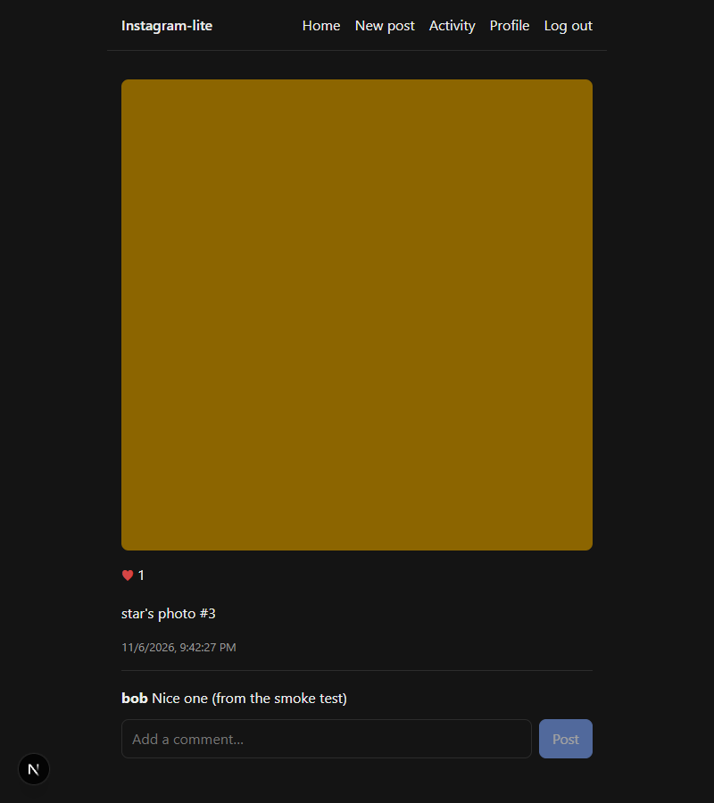
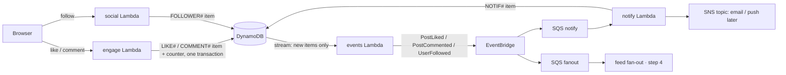

# Step 5: Likes, comments, notifications

## What got built

- **Like / unlike** a post (♡ → ♥, updates instantly). The count is exact: double-liking still counts once.
- **Comments** on the post page (oldest first, "More comments" paging).
- **Notifications** ("Activity" in the nav, with an unread badge): someone liked your post,
  commented, or started following you. Never for your own actions.
- Every notification is also published to an **SNS topic**. That's where email/push senders would plug in.
- The big change: **events now come from the database's change stream** (DynamoDB Streams), not
  from the API code. Step 4's follow event was moved to this too.



## How it fits



## The ideas to learn

### 1. The dual-write problem → change data capture (CDC)
The naive way: save the like, *then* publish "PostLiked". If the publish fails (timeout, crash)
the like exists but nobody hears about it. If you publish first and the save fails, you announce
something that never happened.
**Fix:** write once. DynamoDB Streams records every change, and a Lambda turns new rows into events.
The event exists **because** the row exists. (In SQL databases the same idea is the
**transactional outbox**: insert the event row in the same transaction and a relay publishes it.)
Code: `services/src/events/map.ts` (row → event) and `publisher.ts`.

### 2. Exact counters
The like item and `likeCount + 1` go in **one transaction**, with a condition that the like
didn't exist. No double counts, no drift. The tradeoff: every like on one post updates the same
item, so a viral post becomes a **hot key** (see the table below).

### 3. Unread counts without updating every row
"Mark all read" writes one marker (`lastReadAt`). Unread = notifications newer than it.
That's 1 write instead of N.

### 4. Optimistic UI
The heart flips **before** the server answers, then settles on the real count (or flips back on
error). Feels instant. Every big app does it.

### 5. Idempotent consumers, again
A stream or queue can deliver twice. Notification ids are derived from the source event
(e.g. `comment:<commentId>`), so a redelivery overwrites instead of duplicating.

## How big companies do it

| Here | At scale |
|---|---|
| `likeCount` on the post item | **Sharded counters** (N counter items, summed on read) or async aggregation (stream → batch increments), because one viral post would throttle a single item |
| One notification per event | **Aggregation**: "alice and 52 others liked your post", batched digests, per-user rate limits |
| SNS topic with no subscribers | SNS → email (SES), mobile push (APNs/FCM), with user preferences + quiet hours |
| DynamoDB Streams → Lambda | Same (or Kinesis/Kafka + Debezium for SQL databases); **EventBridge Pipes** can do stream → bus with no code |
| Comments in the post's partition | Separate comments store with spam filtering, ranking ("top comments"), and moderation |

## Interview angle
- *"How do you keep the DB and events consistent?"* Outbox / CDC, never dual writes.
- *"Design the like button for a post with 10M likes."* Idempotent like records, sharded or async
  counters, show approximate counts, cache hot posts.
- *"Design notifications."* Events → queue → notification service → store + channels (push/email/in-app),
  idempotency, aggregation, preferences, rate limits.

## Poke it
```powershell
npm run smoke engage          # likes, comments, notifications via CDC
aws dynamodb describe-table --table-name ig-local-main --query "Table.StreamSpecification"
aws lambda list-event-source-mappings --function-name ig-local-events
```
In the UI: log in as **alice**. Open Activity: bob's follow (from the seed) is there. Like one of
star's posts as bob, then check star's Activity.
