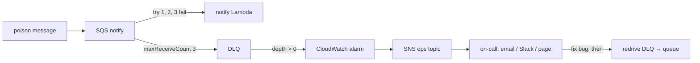

# Step 6: Ops: knowing when it breaks, and fixing it

## What got built

- **Structured JSON logs** (AWS Lambda Powertools) in every background worker, with
  correlation keys (`postId`, `messageId`, `authorId`). One photo can be followed through the pipeline.
- **Alarms** on every dead-letter queue (uploads, fanout, notify, CDC) and on failed pipeline runs,
  all notifying an **ops SNS topic** (on AWS: email / Slack / PagerDuty; locally: an inbox queue).
- **Log retention**: every function has its own log group kept 14 days (no "logs forever" bill).
- **Ops CLI**: `npm run ops -- status | chaos | redrive <queue> | purge <queue> | inbox | logs <fn>`.

## Break it on purpose (do this!)

```powershell
npm run ops -- status          # all DLQs 0, alarms OK
npm run ops -- chaos           # sends a poison message to the notify queue
npm run ops -- logs notify     # watch "notify failed" errors (JSON) as it retries
# ~3 min later (3 tries × 60 s visibility timeout):
npm run ops -- status          # notify DLQ = 1, ig-local-notify-dlq-not-empty = ALARM
npm run ops -- inbox           # the alarm notification the on-call person would get
npm run ops -- purge notify    # it's garbage: drop it (or `redrive notify` after fixing a real bug)
```
`npm run smoke ops` runs this whole story automatically (~4 min).



## The ideas to learn

### 1. Logs, metrics, traces (the three pillars)
- **Logs**: what happened, in detail. **Structured** (JSON) so you can query them:
  `fields @timestamp, message | filter postId = "…"` in CloudWatch Logs Insights.
- **Metrics**: numbers over time (queue depth, errors, latency p99). Cheap, good for alarms.
- **Traces**: one request across services (AWS X-Ray / OpenTelemetry). The next step up from correlation ids.

### 2. Alert on symptoms, not causes
Don't page someone because CPU is high. Page them because **users are affected**: messages giving
up (DLQ > 0), photos failing, error rate up, latency up. Every alarm here links to a runbook (this doc).

### 3. Dead-letter queues + redrive
A DLQ keeps failed messages instead of losing them. The workflow: alarm → look at the message
and the logs → fix the bug → **redrive** (move messages back) → they succeed. AWS has a
"Start DLQ redrive" button. Our `ops redrive` does the same by hand, so you can see the mechanics.

### 4. Change-stream failures
The CDC stream (step 5) now has its own **on-failure DLQ**. After 10 failed tries, or once a
record is an hour old, the record's position goes there and the alarm fires, instead of being silently dropped.

## Known gap (good interview talking point)
`PostPublished` is still sent by the Step Functions Publish step *after* Save: a dual write.
Publish retries, and its failure is caught and alarmed, so the risk is small. The pure fix is the same as step 5:
derive it from the post's status changing to READY on the table stream.

## How big companies do it

| Here | At scale |
|---|---|
| Powertools JSON logs + Logs Insights | Same, plus central log platforms (Datadog, Splunk, OpenSearch), sampling of debug logs |
| Correlation ids in logs | **Distributed tracing** (X-Ray / OpenTelemetry) across every hop |
| DLQ + pipeline alarms | **SLOs** (e.g. 99.9% of photos ready in < 30 s) with error-budget alerts, dashboards per service |
| SNS ops topic | PagerDuty/Opsgenie rotations, escalation, incident channels, postmortems |
| Manual chaos command | **Chaos engineering** (AWS Fault Injection Service), game days |

## Poke it
```powershell
npm run ops                     # status
npm run ops -- logs fanout      # structured logs of the fan-out worker
aws cloudwatch describe-alarms --alarm-name-prefix ig-local --query "MetricAlarms[].[AlarmName,StateValue]"
```
Floci notes: custom log groups from CloudFormation are stubbed and Lambda logs stay in their
containers (so `ops logs` reads `docker logs`); Step Functions metrics aren't emitted, so the
pipeline-failed alarm only works on real AWS. Details in `floci-compat.md`.
