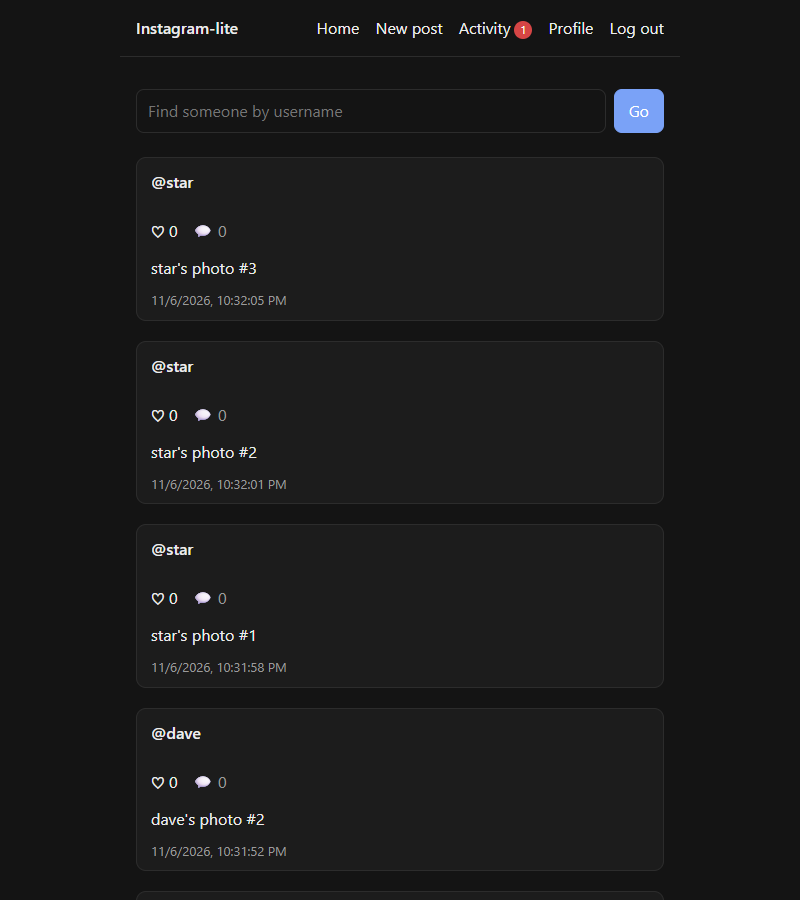
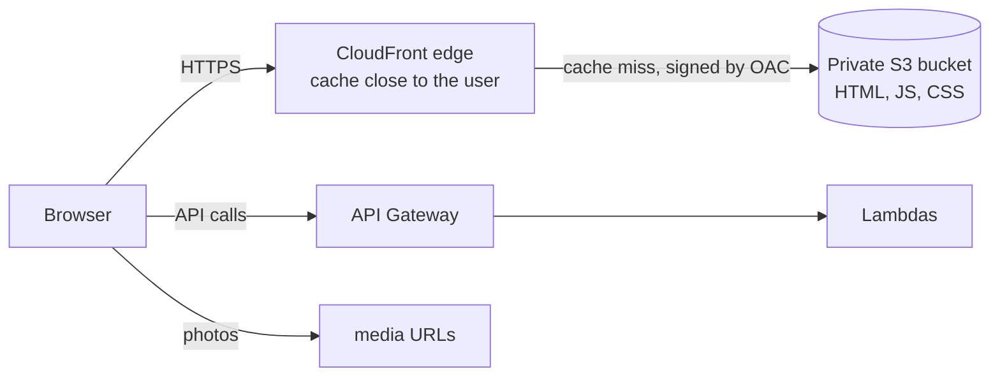

# Step 7: Hosting the web app (S3 + CloudFront)

## What got built

- A **private S3 bucket** with the Next.js static export (`web/out`).
- A **CloudFront distribution** in front of it, with **Origin Access Control (OAC)**: only CloudFront can
  read the bucket; nobody can hit S3 directly.
- `npm run deploy:web`: build → upload with the right **content types and cache headers** → **invalidate** CloudFront.
- Locally the app is now served at `http://<id>.cloudfront.localhost.floci.io:4566/login` (the command prints the URL).
- Floci now keeps its state across restarts (`FLOCI_STORAGE_MODE=persistent`), so a laptop reboot no longer wipes everything.



## How it fits



## The ideas to learn

### 1. What a CDN does
CloudFront has hundreds of **edge locations**. The first visitor near an edge triggers a fetch
from S3 (a cache miss); everyone after gets the cached copy in a few ms. Benefits: speed, less
load on the origin, DDoS absorption, and HTTPS at the edge.

### 2. Cache headers decide everything
| File | Cache-Control | Why |
|---|---|---|
| `_next/static/*.js/.css` | `max-age=31536000, immutable` | the file name contains a content hash; a new build = a new name |
| `*.html` | `no-cache` | always revalidate, so a deploy shows up immediately |
| photos (`media/…`) | `max-age=31536000, immutable` | set in step 3: a post's image never changes |

That's why **cache invalidation** is only needed for HTML (we invalidate `/*` to keep it simple; the
first 1,000 paths per month are free).

### 3. Origin Access Control (OAC)
The bucket blocks all public access. CloudFront signs its requests to S3, and the bucket policy allows
only that distribution. It replaced the older "OAI".

### 4. Pretty URLs on a static site
Static export makes `login.html`; users visit `/login`. Options: a **CloudFront Function** that
rewrites `/login` → `/login.html` (most common), or upload a copy under the extensionless key
(what we do, since Floci doesn't run CloudFront Functions). Both are legit.

## Next.js with server-side rendering (SSR) on AWS: how companies do it

Our app is **static** (every page is a client component that calls the API). Companies needing
SSR (SEO, personalised HTML) pick one of these:

| Option | How | Notes | On Floci? |
|---|---|---|---|
| **Vercel** | Their platform (made by the Next.js team) | Easiest; not AWS | n/a |
| **AWS Amplify Hosting** | Managed Next.js hosting on AWS | Git push → deployed; less control | Not emulated |
| **OpenNext / SST** | Next.js server → Lambda, assets → S3, CloudFront routes between them; ISR via SQS + DynamoDB | What many AWS shops run: serverless, cheap at low traffic | Partly: S3/Lambda/CloudFront exist, but CloudFront Functions and caching aren't emulated, so expect gaps |
| **Containers** | `next start` in Docker on ECS Fargate / App Runner behind a load balancer | Simple mental model, always-on cost | Needs VPC/ALB (banned by our cost rule) |

Interview answer: *"Static + CDN when pages don't need per-request HTML (like ours, where the API does the work).
SSR via OpenNext on Lambda + CloudFront when SEO or first-paint for logged-out pages matters."*

## How big companies do it

| Here | At scale |
|---|---|
| One distribution, default cache policy | Multiple behaviors (`/api/*` → API, `/static/*` → S3), custom cache policies, WAF rules, custom domain + ACM certificate |
| Invalidate `/*` per deploy | Versioned asset paths + invalidate only HTML; blue/green static deploys |
| Images via signed S3 URLs | Images via CloudFront too (signed cookies/URLs for private media), resized at the edge |
| `aws s3 sync`-style script | CI/CD pipeline step after tests |

## Poke it
```powershell
npm run deploy:web             # build + upload + invalidate; prints the CloudFront URL
npm run smoke cdn              # browser login through CloudFront
curl -I http://<id>.cloudfront.localhost.floci.io:4566/_next/static/...   # see Cache-Control
```
Floci notes: CloudFront works over plain HTTP locally (no TLS), custom error pages aren't applied,
and CloudFront Functions don't run. `floci-compat.md` has the details.
