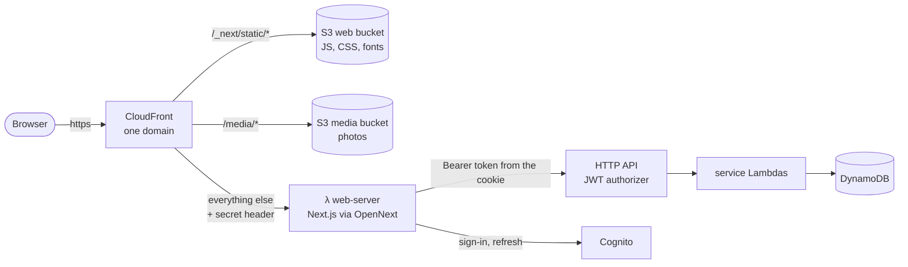

# Step 9: Server-side rendering (Next.js on Lambda, BFF, cookie login)

## What got built
- Every page (feed, profile, post, activity, me) is **rendered on a server** and arrives with the data
  already in the HTML. No more empty page followed by "loading…".
- The server is **one Lambda function** (`ig-<stage>-web-server`) built by **OpenNext** from our Next.js app.
- **One domain** serves everything through CloudFront: pages, JS/CSS, and photos.
- **Login lives in httpOnly cookies.** JavaScript in the page can never read a token.
- The browser talks **only** to our Next.js server (the **BFF**). The HTTP API from steps 1-8 is unchanged,
  but no browser calls it any more, so its CORS is gone.

## Why SSR?
| Before (static export, step 7) | Now (SSR) |
|---|---|
| Browser downloads an empty page, then JS fetches the data | The HTML already has the posts in it |
| Token in `localStorage`, readable by any script on the page | Token in an httpOnly cookie, invisible to scripts |
| Browser calls the API on another domain (CORS) | Browser calls its own site; the server calls the API |
| Link previews (WhatsApp, Slack) see an empty page | They see real content |

The cost: a server runs for every page view. On Lambda that's still about $0 when nobody visits.

## How a request flows



- `/_next/static/*`: file names contain a hash, so CloudFront and browsers cache them for a year.
- `/media/*`: the photos. The API now returns `/media/<post>/thumb.jpg` instead of a signed S3 link.
- Everything else goes to the Lambda and is **never cached**, because every page is personal.

## The BFF (backend-for-frontend)
"BFF" means: a small server made for one frontend, sitting between the browser and your real APIs.
- **Server components** (`web/app/*/page.tsx`) read the `ig_id` cookie and call the API with `Authorization: Bearer …`.
- **Browser actions** (like, comment, follow, load more, upload) call `/bff/api/...`.
  `web/lib/server/forward.ts` has an **allowlist** of what may be forwarded. Anything else gets a 404.
- **Login** goes to `/bff/auth/signin|signup|confirm|resend|signout|refresh`. These talk to Cognito
  and set the cookies.
- Photo bytes still go **straight from the browser to S3** with a presigned URL. Lambdas never carry big files.

## Cookie login
| Cookie | Holds | Sent to | Lives |
|---|---|---|---|
| `ig_id` | Cognito ID token | the whole site (`Path=/`) | 1 hour |
| `ig_refresh` | refresh token | only `/bff/auth/*` | 30 days |

Both are `HttpOnly` (scripts can't read them) and `SameSite=Lax`. On AWS they're also `Secure` (https only).
Locally Floci is plain http, so `Secure` is off there.

**When the ID token expires**, `web/proxy.ts` notices before the page renders and sends the browser to
`/bff/auth/refresh?next=/feed`. The refresh cookie is only sent there. That route swaps it for a new
ID token and sends you back. If that fails, you land on `/login`. A `fetch` that gets a 401 does the same
with one `POST /bff/auth/refresh` and retries once (`web/lib/api.ts`).

## CSRF: why another site can't post as you
Cookies are sent automatically, so another site could try to make your browser POST to us. Two defences:
1. **SameSite=Lax**: the browser doesn't attach our cookies to a POST that starts on another site.
2. **Origin + JSON check** in `proxy.ts` (`lib/server/csrf.ts`): every `/bff/*` POST/PUT/DELETE must come
   from our own origin and send `content-type: application/json`. A cross-site HTML form can't send JSON.

## The secret header (why the Lambda URL is public but safe)
The Lambda has a **Function URL** with `authType: NONE`. CloudFront adds a header
`x-origin-verify: <secret>` to every request, and `proxy.ts` answers **403** to anything without it.
So you can't skip CloudFront (and its HTTPS and security headers) by calling the Lambda directly.
The secret is the random id at the end of the stack's own ARN, so there's nothing to manage.

The stricter AWS option is **Origin Access Control (OAC) for Lambda**: CloudFront signs every request.
But then each browser POST must also carry a hash of its body (`x-amz-content-sha256`), which plain
`fetch` and forms don't send. Floci doesn't emulate it either. So we use the header, and OAC is the upgrade path.

## Cold starts
A Lambda that hasn't run for a while needs to start a fresh copy first, the **cold start**.
For this server that's roughly 0.5-1.5 s on AWS with 1024 MB (more memory = more CPU = faster start).
Warm requests take tens of milliseconds (about 40 ms through Floci's CloudFront here).
Ways to hide cold starts, from cheapest: keep the bundle small, raise memory, a scheduled "warmer" ping,
or **provisioned concurrency** (always-warm copies, costs money every hour). We use none: it's a demo.

## Cost on AWS
- **Lambda**: 1M requests and 400,000 GB-seconds a month are free. One page at 1024 MB for 100 ms is
  0.1 GB-s, so about 4 million page views a month fit in the free tier.
- **Function URL**: free. **CloudFront**: covered by the free plan. **CloudFront Function**: $0.10 per million.
- **Idle cost: $0.** No VPC, no NAT gateway, no container running all night.

## Floci notes (details in [floci-compat.md](floci-compat.md))
- Floci's CloudFront only proxies to a Function URL host listed exactly in its settings. `deploy:web`
  writes it to `.env` as `SSR_ORIGIN_HOST` and restarts Floci when it changes.
- Floci's CloudFormation drops the behaviours' allowed methods and policies, so `deploy:web` re-applies
  them through the CloudFront API.
- CloudFront Functions don't run on Floci, so the server is told the local CloudFront URL directly.
- Floci leaves out folders named like `[...path]` when it unzips a Lambda, so the BFF route uses `[a]/[b]/[c]` instead.

## How big companies do it
| Here | At scale |
|---|---|
| Our own CDK construct around OpenNext | **Vercel** (made by the Next.js team) runs this for you. On AWS, **SST** or **OpenNext** + CDK does the same, usually with streaming, ISR caches and image optimization added |
| One BFF for one web app | **Netflix** made the BFF pattern famous: one small backend per client (TV, phone, web), each shaped for that screen, all calling the same core services |
| Photos public by unguessable URL | Private media behind **CloudFront signed cookies** or signed URLs, so only logged-in viewers can load them |
| Secret origin header | **OAC for Lambda** (CloudFront signs requests; the browser sends a body hash), or a private origin inside a VPC |
| Nothing cached (pages are personal) | Cache the parts that aren't personal: logged-out pages, public profiles, at the edge with short TTLs; **streaming** sends the page top first |
| One region | Multi-region servers or edge runtimes to cut latency far from the region |

## Poke it
```powershell
npm run deploy:web            # build with OpenNext, deploy, prints the CloudFront URL
npm run smoke ssr             # HTML, cookies, CSRF, BFF, the secret header, all checked with plain HTTP
curl.exe -s -i http://<cdn>/feed                     # 307 → /bff/auth/refresh → /login (logged out)
curl.exe -s -i http://<function-url-host>:4566/login  # 403: no secret header
```
Then log in as bob in the browser, open DevTools → Application → Cookies, and look at the HttpOnly column.
Type `document.cookie` in the console: no token there.

Code to read: `web/proxy.ts` + `web/lib/server/gate.ts`, `web/app/bff/auth/*`, `web/lib/server/forward.ts`,
`infra/lib/web.ts`.
