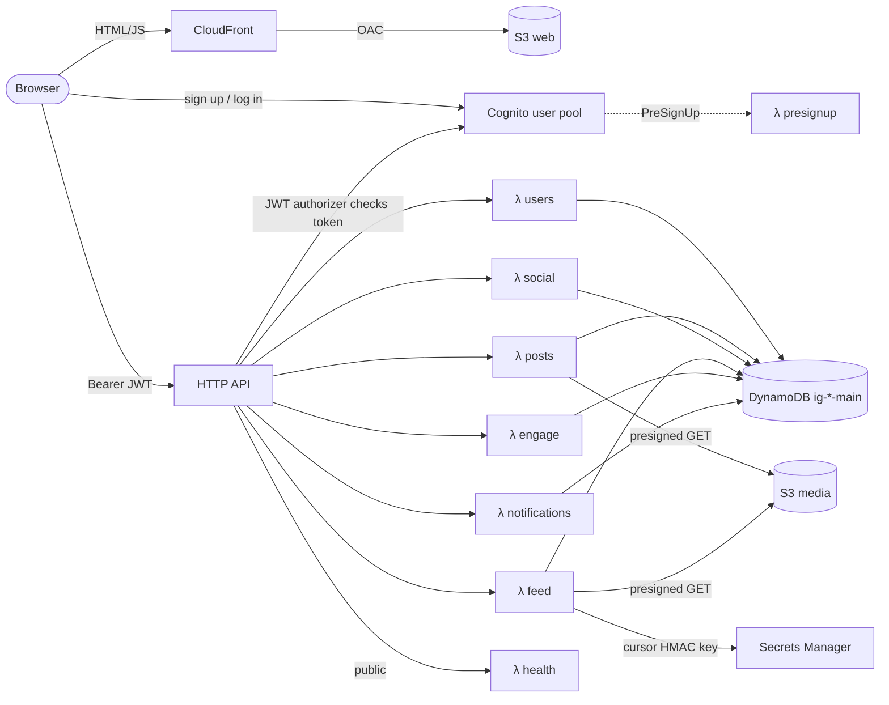
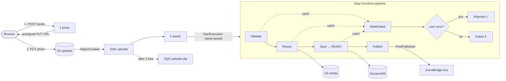
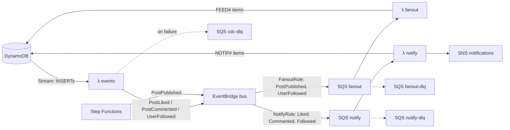
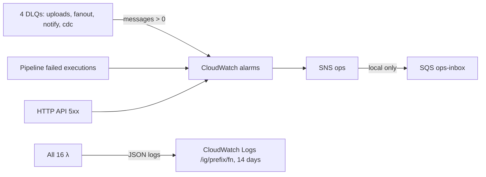

# Architecture: everything in the `ig-<stage>-core` stack

Drawn from `infra/lib/*.ts` (one CDK stack). Same diagram for Floci and real AWS; only endpoints differ.
16 Lambdas, 1 DynamoDB table, 3 S3 buckets, 1 state machine, 1 event bus, 7 SQS queues, 2 SNS topics, 6 alarms.

## 1. Request path (browser → API → table)

## 2. Upload pipeline

## 3. Events: fan-out, CDC, notifications

## 4. Ops

