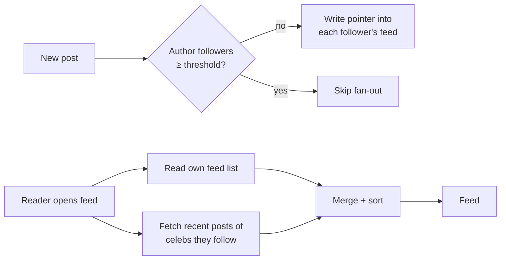

# System design notes

Grows with each build step. Short, interview-style.

---

## 1. News feed: how do you build the home feed?

**The question:** you follow 200 people. Open the app, and you see their latest posts, newest first. How?

### Option A: Fan-out on read (pull)
When you open the feed, fetch the recent posts of everyone you follow, merge them, sort.

- Writes are cheap: a post is stored once.
- Reads are slow: 200 lookups and a merge on every refresh.
- Fine for small apps, bad at scale.

### Option B: Fan-out on write (push)
When someone posts, copy a pointer to that post into each follower's feed list.

- Reads are fast: your feed is already built, one query.
- Writes are expensive: a post by someone with 10M followers = 10M writes.
- That's the **celebrity problem**.

### Option C: Hybrid (what Instagram/Twitter do), used in this project
- Normal users → **push** (fan-out on write).
- Celebrities (followers ≥ threshold) → **pull** at read time.
- Your feed = your pre-built list + recent posts from celebs you follow, merged.

**Interview angle:** start with pull, say why it doesn't scale, move to push, name the
celebrity problem, land on hybrid. Mention: feed stores only IDs (not full posts),
cursor pagination, feed can be trimmed (keep last ~500 items).

**In this project:** threshold = 3 locally so you can see both paths with test users.
