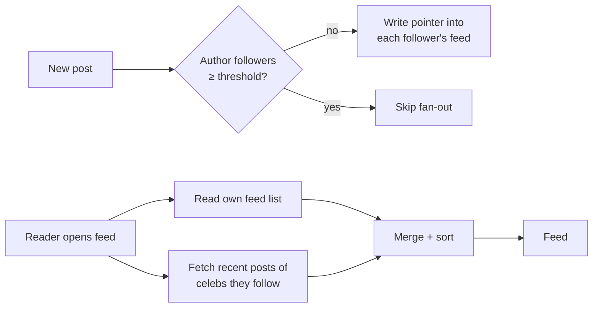
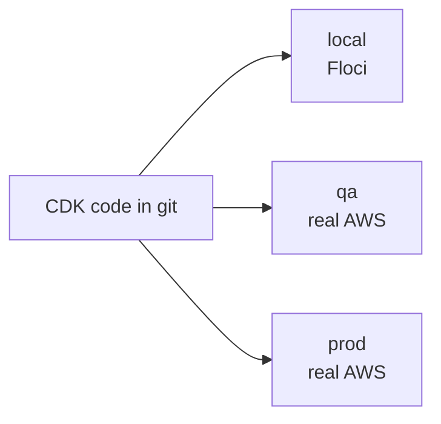
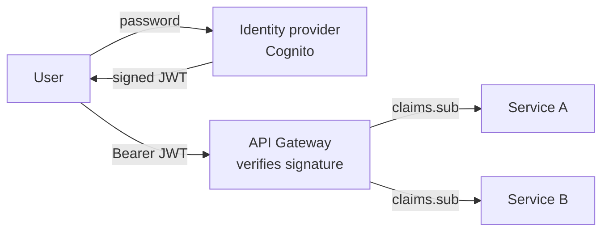

# System design notes

Grows with each build step. Short, interview-style.

---

## 1. News feed: how do you build the home feed?

**The question:** you follow 200 people. Open the app, and you see their latest posts, newest first. How?

### Option A: Fan-out on read (pull)
When you open the feed, fetch the recent posts of everyone you follow, merge them, sort.

- Writes are cheap: a post is stored once.
- Reads are slow: 200 lookups and a merge on every refresh.
- Fine for small apps, bad at scale.

### Option B: Fan-out on write (push)
When someone posts, copy a pointer to that post into each follower's feed list.

- Reads are fast: your feed is already built, one query.
- Writes are expensive: a post by someone with 10M followers = 10M writes.
- That's the **celebrity problem**.

### Option C: Hybrid (what Instagram/Twitter do), used in this project
- Normal users → **push** (fan-out on write).
- Celebrities (followers ≥ threshold) → **pull** at read time.
- Your feed = your pre-built list + recent posts from celebs you follow, merged.

**Interview angle:** start with pull, say why it doesn't scale, move to push, name the
celebrity problem, land on hybrid. Mention: feed stores only IDs (not full posts),
cursor pagination, feed can be trimmed (keep last ~500 items).

**In this project:** threshold = 3 locally so you can see both paths with test users.

---

## 2. Environments + infrastructure as code

**The question:** how do teams ship the same system to dev, QA and prod without "works on my machine"?

- **Infrastructure as code (IaC):** the cloud setup lives in git as code (CDK, Terraform).
  It gets reviewed, versioned and repeated exactly. No console clicking.
- **One template, many stages:** the same code with a `stage` parameter, so names, sizes and
  settings differ per environment and nothing else does.
- **Guardrails:** separate accounts per stage, plus checks that stop a deploy to the wrong one.
- **Local emulators** (Floci, LocalStack) for the fast inner loop. **Real cloud** for what
  emulators fake: IAM permissions, networking, limits, real latency.

**Interview angle:** mention IaC, immutable deploys (replace, don't patch), one account per
environment, and the testing pyramid: unit → local emulator → cloud integration.

**In this project:** `-c stage=local` → Floci, `-c stage=aws` → your real account. The guard
lives in `infra/lib/config.ts`.

---

## 3. Authentication at scale (JWTs)

**The question:** millions of users and dozens of services. How does each service know who's calling?

- **Option A, server sessions:** login creates a session id stored in a shared store (Redis).
  Every request does a lookup. Easy to revoke, but every request hits the store.
- **Option B, JWTs:** login returns a signed token carrying the user id. Any service verifies
  the signature locally with a public key, with no lookup. Scales well, but you can't easily "un-issue"
  a token, so keep it short-lived (1 hour) plus a refresh token.
- **Where to check:** once, at the gateway (API Gateway JWT authorizer), so services trust the verified claims.

**Interview angle:** stateless vs stateful auth, token expiry + refresh, revocation
(short TTL, deny-list for emergencies), never trust ids from the request body.

---

## 4. Data modelling in DynamoDB (single table)

**The question:** how do you store users, posts, likes, follows and feeds in a NoSQL key-value store?

- **Start from access patterns**, not entities: "get profile by id", "get profile by username",
  "list a user's posts newest first"... Each pattern becomes a key design.
- **One table, prefixed keys:** `USER#123 / PROFILE`, `UNAME#ann / UNAME`, `POST#9 / LIKE#123`.
  Related items share a partition key, so one query fetches them together.
- **GSI** (global secondary index) = a second key layout over the same items, for patterns the main key can't serve.
- **Uniqueness:** there's no UNIQUE constraint, so write a claim item with `attribute_not_exists`, in a
  **transaction** with the main item.
- **Hot partitions:** one very popular key (a celebrity's follower list) can throttle. Spread load
  (sharded keys) or change the pattern. This comes back in the feed step.

**SQL vs DynamoDB in interviews:** SQL gives flexible queries + joins (good when patterns are unknown).
DynamoDB gives predictable single-digit-ms reads at any scale, but you must know your queries up front.

**In this project:** profile + username claim (`services/src/users/repo.ts`); the race test
proves only one of two simultaneous claims wins.
