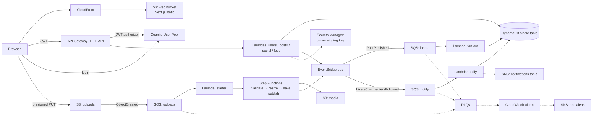

# Instagram-lite on AWS: Design

Date: 2026-11-06 · Status: reviewed with Aman

## Why

Aman wants to learn AWS and system design at the same time, by building something
the way an org does: infrastructure as code, a local environment, then a real cloud
environment. It also doubles as a pilot for his org, which deploys everything to AWS
and wants to test locally before AWS QA.

This is a **learning app, not a product.** Every feature exists because it teaches
an AWS service or a system design idea. No feature is there "because users want it".

## Goals

- A small Instagram clone that uses many AWS services the way real orgs wire them.
- The whole app (UI + API + DB + queues) runs on Aman's laptop via **Floci**, usable in a browser.
- The **same CDK code** deploys to a real AWS free-tier account later.
- Built **step by step**: each step ships something working, with a short chat
  explainer + a `docs/learn/NN-*.md` file with a diagram.
- System design notes kept in parallel (`docs/learn/system-design-notes.md`) so it
  doubles as interview prep.

## Non-goals

- No CI pipeline (Aman explicitly said no).
- No QA/prod split. Only two envs: `local` (Floci) and `aws` (one real stack).
- No polish: no mobile app, no video, no stories, no DMs, no search.
- Not production hardened. Good practice is shown, but not exhaustive.

## Anti-goals (failure even if it works)

- Real AWS bill beyond pennies. **Banned on AWS: VPC, NAT Gateway, RDS, ECS/Fargate, ALB.** Serverless only.
- Building everything in one go and dumping it. Each step must be understandable on its own.
- Code that only works on Floci or only on AWS. One codebase, one config switch.

## Decisions (Aman's)

| Topic | Decision |
|---|---|
| Goal | Learning + org pilot |
| App | Instagram-lite (common system design interview topic) |
| Language | TypeScript everywhere (CDK, Lambdas, UI) |
| Runs on | Floci first, then real AWS |
| Envs | `local` + one `aws` |
| CI | None |
| UI | Next.js, **static export to S3**. Also *learn* how companies do Next.js SSR on AWS and whether Floci can run it |
| Features | All: auth + profile, photo upload + resize, follow + feed, likes, comments, notifications |
| AWS services | Core (S3, Lambda, API Gateway, DynamoDB), Async (SQS, SNS, EventBridge), Auth/secrets (Cognito, Secrets Manager), Ops (CloudWatch, Step Functions) |
| Feed design | Aman delegated this. Pick the right interview answer and teach it |
| AWS account | Create after local works, with a **$5 budget alert** first thing |
| Cost rule | Ban VPC/NAT/RDS on AWS |
| Folder | `C:\Aman\Coding-Bamzii\Web Development\aws\instagram-lite` |
| Learning | Step by step. Short chat + `docs/learn` file with diagram per step |
| Org pilot deliverable | `docs/learn/floci-compat.md`: what worked or broke on Floci, per service, shareable with the team |
| Structural calls | Step Functions upload pipeline + hybrid feed: **approved by Aman** |
| Who codes | Claude builds each step. Aman runs and checks it; **next step starts only after Aman's OK** |

## Architecture

### Pieces and what each teaches

| Piece | AWS service | Lesson |
|---|---|---|
| Login / sign-up | Cognito user pool + HTTP API JWT authorizer | Managed auth, JWTs, API protection |
| REST API | API Gateway HTTP API → Lambda (Node 22, TS) | Serverless API, one Lambda per domain |
| Data | DynamoDB **single-table design** | Access patterns first, PK/SK modelling, GSIs, atomic counters |
| Photo upload | S3 **presigned PUT URL** | Clients upload straight to S3, never through your API |
| Upload buffer | S3 event → SQS (+ DLQ) | Decoupling, retries, backpressure |
| Processing | Step Functions: validate → resize → save → publish | Workflows, retries per step, visible state |
| Resize | Lambda using **jimp** (pure JS) | Media pipeline; why orgs use `sharp`/layers instead |
| Events | EventBridge custom bus | Event-driven design, services don't call each other |
| Feed | Hybrid fan-out (below) | The core interview topic |
| Notifications | EventBridge rule → SQS → Lambda → DynamoDB + SNS | Pub/sub, fan-out to channels |
| Secrets | Secrets Manager: HMAC key signing feed pagination cursors | Never hardcode secrets; tamper-proof cursors |
| Ops | CloudWatch structured JSON logs; alarm on DLQ depth > 0 → SNS | Observability, "know when something broke" |
| UI hosting | S3 + CloudFront | How orgs host static frontends |

### Feed design (my call, since Aman delegated it)

**Hybrid fan-out**, the answer interviewers look for:

- **Normal author** (followers < `CELEB_THRESHOLD`): on `PostPublished`, the fan-out Lambda
  writes a feed item into each follower's feed partition (**fan-out on write**). Reads are cheap.
- **Celebrity author** (followers ≥ threshold): no fan-out. At read time the feed Lambda
  merges the reader's pre-built feed with the recent posts of the celebs they follow
  (**fan-out on read**). This avoids writing millions of rows for one post.
- `CELEB_THRESHOLD` is config: **3 locally** (so Aman can see both paths with a handful of
  test users), 10,000 noted as a "real world" value.
- Feed items keep only `postId + authorId + createdAt`. Post data is fetched in a batch
  (`BatchGetItem`). Teaches normalisation vs duplication.
- Pagination: cursor-based, cursor signed with the Secrets Manager key.

All three options (write / read / hybrid) with tradeoffs go in `docs/learn/system-design-notes.md`.

### DynamoDB single table (starting point; the builder may refine)

| Entity | PK | SK | Notes |
|---|---|---|---|
| Profile | `USER#<id>` | `PROFILE` | username, bio, avatarKey, followerCount, followingCount, postCount |
| Username claim | `UNAME#<name>` | `UNAME` | uniqueness via conditional put |
| Following | `USER#<id>` | `FOLLOWS#<otherId>` | |
| Follower | `USER#<id>` | `FOLLOWER#<otherId>` | written together with Following in a transaction |
| Post | `POST#<id>` | `POST` | authorId, caption, status (`PENDING/READY/FAILED`), media keys, likeCount, commentCount |
| User's posts | GSI1: `USER#<id>` | `POST#<ts>#<id>` | profile grid + celeb fan-out-on-read |
| Feed item | `FEED#<userId>` | `<ts>#<postId>` | written by fan-out; TTL optional |
| Like | `POST#<id>` | `LIKE#<userId>` | conditional put = one like per user |
| Comment | `POST#<id>` | `COMMENT#<ts>#<id>` | |
| Notification | `NOTIF#<userId>` | `<ts>#<id>` | type, actor, postId, read flag |

### API (HTTP API, all JWT-protected except health)

`GET /health` · `GET/PUT /me` · `GET /users/{username}` · `POST/DELETE /users/{id}/follow` ·
`POST /posts` (returns presigned URL) · `GET /posts/{id}` · `GET /users/{id}/posts` ·
`GET /feed?cursor=` · `POST/DELETE /posts/{id}/like` · `GET/POST /posts/{id}/comments` ·
`GET /notifications` · `POST /notifications/read`

### UI (Next.js static export)

Pages: login/sign-up, home feed, upload, profile (grid + follow button), post detail
(likes, comments), notifications. Client-side data fetching only (static export has no server).
Cognito login via the Amplify Auth library or `amazon-cognito-identity-js` (builder's choice).
Locally the UI can also run with `next dev` for fast iteration; the S3/CloudFront build is the "deployed" version.

## Local vs AWS

- One CDK app, `-c stage=local|aws`. `local` points the CDK/CLI/SDK at Floci via `AWS_ENDPOINT_URL`.
- Things that differ per stage go in one config file: endpoint, `CELEB_THRESHOLD`, CloudFront URL
  format, JWT private-issuer flag (`FLOCI_SECURITY_ALLOW_PRIVATE_JWT_TARGETS=true` locally),
  removal policy (destroy everything on both, it's a learning app).
- Seed script: creates ~6 test users (one "celeb"), follows, and a few posts, so the feed paths are visible right away.

### Known Floci risks (from its docs, not yet tested)

| Risk | Plan |
|---|---|
| CDK not formally documented on Floci; `cdk bootstrap` not mentioned | **Step 1 is a spike** that proves `cdk deploy` works. Fallbacks: `cdk synth` + deploy template via CloudFormation directly, or `cdklocal` |
| CDK custom resources (e.g. `BucketDeployment`, `autoDeleteObjects`) need Lambda + TLS | Avoid them. Upload UI with `aws s3 sync` script |
| Cognito local issuer blocked by default for JWT authorizers | Set the private-JWT flag locally |
| CloudFront URLs: `{id}.cloudfront.localhost.floci.io`; caching/functions not run | Fine for learning; `next dev` and S3 website URL as fallbacks |
| `*.localhost` hostnames may behave differently on Windows | Test in step 1; fall back to path-style URLs |
| Lambda needs Docker running | Docker Desktop is installed; must be running |
| S3 events must use `ObjectCreated:*` | Use that |

## Next.js SSR: how companies do it (a learning step, not the main path)

| Way | How | Cost/notes | On Floci? |
|---|---|---|---|
| Vercel | Their platform, not AWS | Easiest | No |
| AWS Amplify Hosting | Managed Next.js hosting | Simple, AWS-managed | Not verified, probably not |
| **OpenNext / SST** | Server Lambda + image Lambda + S3 assets + CloudFront routing | What many AWS shops do, serverless | Pieces exist in Floci; CloudFront functions not executed, so it may partly work |
| Containers (ECS Fargate / App Runner) | Docker image behind a load balancer | Needs VPC/ALB, **banned by cost rule** | n/a |

Plan: a final optional step, "SSR spike with OpenNext on Floci". Throwaway; findings go in the notes.

## Build steps (each ends with something working + a learn doc)

0. **Tools**: Docker, Floci, AWS CLI, CDK installed; `floci start`; make an S3 bucket by hand. *(done while Aman was away)*
1. **Skeleton + spike**: npm workspaces repo (`infra/`, `services/`, `web/`, `scripts/`, `docs/`), CDK app with one DynamoDB table + `/health` Lambda behind HTTP API, deployed to Floci. Next.js hello page. Proves CDK on Floci.
   The spike also creates a throwaway CDK stack that touches **every** service the later steps need
   (Cognito pool + JWT authorizer, S3→SQS event, Step Functions, EventBridge→SQS, SNS, Secrets Manager,
   CloudWatch alarm) and checks each one works. Results go in `docs/learn/floci-compat.md`.
   If one doesn't work: note it and ask Aman before designing around it.
2. **Auth + profile**: Cognito, JWT authorizer, `/me`, username claim, login UI.
3. **Upload pipeline**: presigned PUT, uploads bucket → SQS → starter → Step Functions → resize → media bucket, post status. Upload page + profile grid.
4. **Follow + feed**: follow transaction, EventBridge `PostPublished`, hybrid fan-out, signed cursors (Secrets Manager), home feed UI, seed script.
5. **Likes, comments, notifications**: atomic counters, conditional likes, events → notify → DynamoDB + SNS, notifications UI.
6. **Ops**: DLQs everywhere, CloudWatch alarm on DLQ depth → SNS ops topic, structured logs, a "break it on purpose" exercise.
7. **UI on S3 + CloudFront** locally.
8. **Real AWS**: Aman creates the account (card needed), I guide; root MFA, IAM user/SSO, **$5 budget alert first**; `cdk bootstrap` + deploy `aws` stage; walk the console; `cdk destroy` when done.
9. *(optional)* **Next.js SSR spike** with OpenNext.

Each step: short chat explainer, then `docs/learn/0N-<topic>.md` (what, why, mermaid diagram,
"interview angle", commands to poke it). `system-design-notes.md` grows with each step.

## Left to the builder

- Exact Lambda split, folder names inside `services/`, shared lib layout.
- Cognito UI library choice.
- Test approach (unit tests on handlers + a smoke script against Floci per step).
- Styling (plain CSS / Tailwind; calm, no glow, per Aman's UI preference).
- DynamoDB key tweaks, as long as access patterns are covered.

## My calls (Aman to check)

- Hybrid feed with `CELEB_THRESHOLD=3` locally.
- jimp instead of sharp (avoids native binary trouble in Floci's Lambda containers).
- Secrets Manager used for a cursor-signing key (gives it a real job). Costs ~$0.40/month on AWS.
- Step Functions for the upload pipeline (S3 → SQS → starter Lambda → state machine).
- Avoid CDK custom resources; UI deployed by `aws s3 sync`.
- Git: local commits OK (Aman approved). No remote, no push.
- Notifications: the real channel is in-app (DynamoDB + notifications page). The SNS topic has no
  subscriber locally; on AWS, optionally one email subscription (Aman's) to see SNS deliver. No per-user email/SES.
- Step 1 spike checks every service on Floci, so a gap shows up before any real work depends on it.
